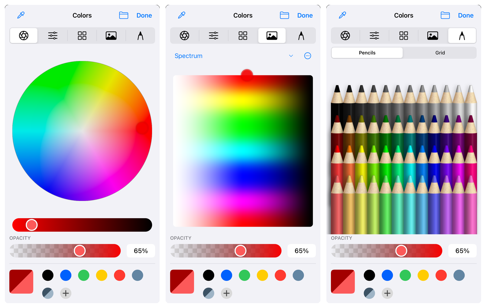

# UIColorPanel

An AppKit-style color panel for **iOS 12 and later**, written in Objective-C with UIKit. Pick a color with the wheel, spectrum, sliders, grid, or colored pencils. Use the shared floating panel to change colors while you work, or embed a picker in your own view controller.



## Try the demo

1. Clone the repository and open the Xcode project.

   ```sh
   git clone https://github.com/Torrekie/UIColorPanel.git
   cd UIColorPanel
   open UIColorPanelKit.xcodeproj
   ```

2. Select the **UIColorPanelDemo** scheme and an iPhone or iPad simulator, then press **Run**.
3. Tap **Open Shared Color Panel** and choose a color. The demo updates as you drag.

## Add it to your app

Build the public SDK from the repository root. The library module is named `UIColorPanelKit`.

```sh
./tools/build-release.sh --variant public
```

1. Copy `.build/releases/UIColorPanelKitPublic` into a `Vendor` directory beside your app’s `.xcodeproj`.
2. Add these lines to an xcconfig beside the project, and use that configuration for your app target in Debug and Release.

   ```xcconfig
   UICOLORPANELKIT_ROOT = $(SRCROOT)/Vendor/UIColorPanelKitPublic
   #include "Vendor/UIColorPanelKitPublic/UIColorPanelKit.xcconfig"
   ```

3. Add the SDK’s entire `UIColorPanelKit.bundle` to **Copy Bundle Resources**. Add its top-level `PrivacyInfo.xcprivacy` to your app target as well. If your app already has a privacy manifest, merge the SDK’s UserDefaults entries into it.

## Open the color panel

In a view controller, connect a button to `showColors:`. This example updates the background as the user picks a color.

```objc
#import <UIColorPanelKit/UIColorPanelKit.h>

- (IBAction)showColors:(id)sender {
    UIColorPanel *panel = [UIColorPanel sharedColorPanel];
    panel.presentationViewController = self;
    panel.color = self.view.backgroundColor ?: UIColor.whiteColor;
    panel.continuous = YES;
    panel.target = self;
    panel.action = @selector(colorChanged:);
    [panel orderFront:sender];
}

- (void)colorChanged:(UIColorPanel *)panel {
    self.view.backgroundColor = panel.color;
}
```

For an embedded picker, use `UIColorPanelViewController`. The public build uses public APIs and saves favorites in the app’s own preferences by default. To build the fifth toolbar page with Grid only, add `--pencils 0` to the SDK build command.

## License

The project’s original code uses the BSD 2-Clause License. The bundled Apple-derived resources retain their respective notices. See the [license](LICENSE) and [localization provenance](reimpl/color_accessibility_api_manifest.json).
